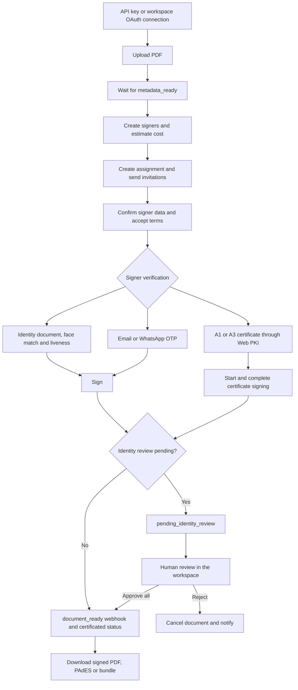

# Assinafy .NET SDK

*[Leia em português](README.md) · English*

A typed .NET client for the [Assinafy](https://api.assinafy.com.br/v1/docs) electronic-signature
API. It covers the complete documented HTTP surface — documents, envelopes, embedded signing, contract tracking, templates, signers, assignments,
the signer-facing signing flow, signature images, tags, fields, webhooks, accounts, users, and the
OAuth 2.1 authorization-code flow — as strongly-typed resources on a single `AssinafyClient`, with
one exception hierarchy, envelope handling, and pagination already taken care of.

Targets `net8.0`, `net9.0`, and `net10.0`.

## Contents

1. [Installation](#installation)
2. [Credentials and environments](#credentials-and-environments)
3. [Creating a client](#creating-a-client)
4. [OAuth 2.1 for multi-workspace apps](#oauth-21-for-multi-workspace-apps)
5. [Dependency injection](#dependency-injection)
6. [How requests and responses work](#how-requests-and-responses-work)
7. [Error handling](#error-handling)
8. [The signature lifecycle](#the-signature-lifecycle)
9. [Documents](#documents)
10. [Templates](#templates)
11. [Signers](#signers)
12. [Assignments](#assignments)
13. [The signer-facing flow](#the-signer-facing-flow)
14. [Signature images](#signature-images)
15. [Public documents](#public-documents)
16. [Tags](#tags)
17. [Fields](#fields)
18. [Webhooks](#webhooks)
19. [Accounts and users](#accounts-and-users)
20. [Reference tables](#reference-tables)
21. [Testing](#testing)
22. [Support matrix and versioning](#support-matrix-and-versioning)
23. [Further reading](#further-reading)
24. [Contract lifecycle management](#contract-lifecycle-management)
25. [Envelopes](#envelopes)
26. [Embedded signing](#embedded-signing)

## Installation

```bash
dotnet add package Assinafy.Sdk --version 2.8.0
```

Use .NET 10 LTS for supported production deployments. The package retains `net8.0` and `net9.0`
compatibility targets, but Microsoft support for those runtimes ended on November 10, 2026.
Contributors use .NET SDKs 8.0.426, 9.0.319, and 10.0.404; [`global.json`](global.json) selects .NET 10
for repository commands.

## Credentials and environments

Assinafy accepts either credential:

| Credential | Sent as | Obtained from | Use for |
|---|---|---|---|
| API key | `X-Api-Key` header | `Authentication.CreateApiKeyAsync` (or the web app) | Server-to-server integrations in **your own** workspace |
| Access token | `Authorization: Bearer …` | `Authentication.LoginAsync` / `SocialLoginAsync` | Acting as a signed-in user |
| OAuth token | `Authorization: Bearer …` | `OAuth.ExchangeCodeAsync` | An app acting in **someone else's** workspace, with their permission |

The first two are mutually exclusive; supplying both throws a `ValidationException`. An OAuth
access token is supplied as `Token`, exactly like any other bearer credential — see
[OAuth 2.1 for multi-workspace apps](#oauth-21-for-multi-workspace-apps). Create a *separate*
user for an API-key integration so it can be granted only the access it needs, and never commit the
key. Results carrying credentials or bearer links redact those values from `ToString()`.

Develop against the sandbox, then switch a single option to go live:

| Environment | API base URL | Web app |
|---|---|---|
| Sandbox | `https://sandbox.assinafy.com.br/v1` | `https://app-sandbox.assinafy.com.br` |
| Production (default) | `https://api.assinafy.com.br/v1` | `https://app.assinafy.com.br` |

Most endpoints are scoped to a workspace **account**. Set `AccountId` once on the client and every
account-scoped method uses it; each of those methods also takes an optional `accountId` override.
`Accounts.ListAsync()` discovers the IDs available to the current credential.

## Creating a client

Use **.NET 10 LTS** for new applications. Every method's parameters, request bodies, responses,
and errors are listed in [docs/API.md](docs/API.md#sdk-method-index).

```csharp
using Assinafy.Sdk;
using Assinafy.Sdk.Models;

using var client = new AssinafyClient(new AssinafyClientOptions
{
    ApiKey = Environment.GetEnvironmentVariable("ASSINAFY_API_KEY"),
    AccountId = Environment.GetEnvironmentVariable("ASSINAFY_ACCOUNT_ID"),
    BaseUrl = "https://sandbox.assinafy.com.br/v1",   // omit for production
    Timeout = TimeSpan.FromSeconds(30),               // default
});
```

Two shorthands exist for common cases:

```csharp
using var fromArgs = AssinafyClient.Create(apiKey, accountId);

using var fromSettings = AssinafyClient.FromConfig(new Dictionary<string, string?>
{
    ["api_key"] = configuration["Assinafy:ApiKey"],
    ["account_id"] = configuration["Assinafy:AccountId"],
});
```

`FromConfig` accepts snake_case or camelCase keys (`api_key`/`apiKey`, `account_id`/`accountId`,
`token`/`access_token`/`accessToken`, `base_url`/`baseUrl`).

**Lifetime.** `AssinafyClient` is thread-safe and holds a pooled `HttpClient`. Create one per
application and reuse it; creating one per request exhausts sockets. Dispose it only when it owns
its transport — the constructors above do; the `HttpClient` overload does not, leaving that client's
lifetime to you.

**Transport hardening.** `BaseUrl` must be an absolute HTTPS URL whose path is exactly `/v1`; user
info, extra path segments, query strings, and fragments are rejected. An SDK-owned transport
disables automatic redirects, because .NET forwards custom headers such as `X-Api-Key` to a
redirect target. If you supply your own `HttpClient`, its `BaseAddress` must match `BaseUrl` and
**you** must disable redirects on its primary handler:

```csharp
using var http = new HttpClient(AssinafyClient.CreatePrimaryHandler())
{
    BaseAddress = new Uri("https://sandbox.assinafy.com.br/v1/"),   // note the trailing slash
};
using var client = new AssinafyClient(
    new AssinafyClientOptions
    {
        ApiKey = apiKey,
        AccountId = accountId,
        BaseUrl = "https://sandbox.assinafy.com.br/v1",
    },
    http);
```

`AssinafyClient.CreatePrimaryHandler()` returns exactly the handler the SDK uses for its own
transport — redirects and cookies disabled, five-minute pooled connection lifetime, and TLS 1.2 or 1.3 only,
because Assinafy refuses older protocols during the handshake (a `NetworkException`, never an HTTP
status).

Credentials are attached per request; the SDK never stores credentials in default headers.
Requests reject a supplied transport with `Authorization`, `X-Api-Key`, or `Cookie` in its default
headers. Configure credentials through `AssinafyClientOptions`. The SDK adds `Accept` and `User-Agent` when absent.
Its `Timeout` is left untouched — set it yourself.

## OAuth 2.1 for multi-workspace apps

Use OAuth when **other people** connect your application to **their own** Assinafy workspace, so you
never handle their password or API key. Automating your own workspace needs none of this — keep
using an API key.

| | API key | OAuth |
|---|---|---|
| Acts on | Your own workspace | Someone else's, with their permission |
| Can do | Everything your account can | Only the scopes the user approved |
| User can switch it off | No | Yes, at any time |

The flow spans two hosts on purpose: the approval page belongs to the authorization server
(`https://auth.assinafy.com.br`), while every call your code makes — the token exchange included —
belongs to this API. Register the application under **Integrations → OAuth apps** in the
Assinafy app; redirect URIs must be `https://` and are matched character for character, so
`…/callback` and `…/callback/` are different URIs.

### 1. Start the connection

PKCE is mandatory for every application, confidential ones included. Create a new pair per attempt
and keep both values in the user's session:

```csharp
using Assinafy.Sdk.Models;
using Assinafy.Sdk.Resources;

var pkce = OAuthResource.CreatePkcePair();     // 256-bit verifier + its S256 challenge
var state = OAuthResource.CreateState();       // CSRF protection

HttpContext.Session.SetString("assinafy_verifier", pkce.CodeVerifier);
HttpContext.Session.SetString("assinafy_state", state);

var authorizationUrl = OAuthResource.BuildAuthorizationUrl(new OAuthAuthorizationRequest
{
    ClientId = clientId,
    RedirectUri = "https://myapp.example.com/oauth/callback",
    Scopes =
    [
        OAuthScopes.DocumentsRead,
        OAuthScopes.DocumentsWrite,
        OAuthScopes.OfflineAccess,      // ask for this to receive a refresh token
    ],
    State = state,
    CodeChallenge = pkce.CodeChallenge,
});

return Redirect(authorizationUrl.ToString());   // a full page navigation, never an AJAX call
```

### 2. Handle the redirect and exchange the code

The user comes back with `?code=…&state=…&iss=…`, or `?error=access_denied&…` if they declined.
Validate `state` and `iss` **before anything else** — if either differs, the response is not yours.
The code is single-use and expires 60 seconds after approval, so exchange it from your server
straight away:

```csharp
if (state is null ||
    state != HttpContext.Session.GetString("assinafy_state") ||
    iss != OAuthResource.DefaultIssuer)
    return BadRequest();

var verifier = HttpContext.Session.GetString("assinafy_verifier");
HttpContext.Session.Remove("assinafy_state");
HttpContext.Session.Remove("assinafy_verifier");

if (error is not null)          // access_denied, invalid_scope, invalid_request, …
    return View("ConnectionFailed", error);

var tokens = await oauth.OAuth.ExchangeCodeAsync(new OAuthCodeExchangeRequest
{
    Code = code,
    RedirectUri = "https://myapp.example.com/oauth/callback",
    CodeVerifier = verifier!,
    ClientId = clientId,
    ClientSecret = clientSecret,    // omit entirely for a public application
});
```

`oauth` is a client your application creates once, as
`new AssinafyClient(new AssinafyClientOptions())`, and uses only for token and revoke calls. It
needs no credential, since those endpoints authenticate with the application's own, and it owns its
transport, so no retry or hedging handler can resend a one-time code or a refresh token (see
[Dependency injection](#dependency-injection)). Read `tokens.Scope` rather than assuming the
request was granted in full:

```csharp
if (!tokens.HasScope(OAuthScopes.DocumentsWrite))
    return View("ReconnectWithWriteAccess");
```

### 3. Find the workspace, then call the API

A token belongs to the **one** workspace the user picked. With an OAuth token the workspace list
returns exactly that workspace — store its ID beside the tokens:

```csharp
using var client = new AssinafyClient(new AssinafyClientOptions { Token = tokens.AccessToken });

var accounts = await client.Accounts.ListAsync();
var accountId = accounts[0].Id;                 // the workspace the user connected

var documents = await client.Documents.ListAsync(accountId: accountId);
```

Calling any other workspace returns `403`, even another one the same user belongs to. If a customer
uses several workspaces, connect each separately and keep tokens per workspace.

### 4. Refresh, and handle a missing scope

Access tokens last one hour. With `offline_access` you can renew without the user: when a call
answers `401`, refresh once, then repeat the call with a client built from the new access token,
because a client keeps the token it was constructed with:

```csharp
var sent = await LoadRefreshTokenAsync(connectionId);   // under this connection's refresh lock

var refreshed = await oauth.OAuth.RefreshTokenAsync(new OAuthRefreshRequest
{
    RefreshToken = sent,
    ClientId = clientId,
    ClientSecret = clientSecret,
});

await SaveTokensAsync(connectionId, refreshed);   // do this FIRST: refresh tokens rotate

using var client = new AssinafyClient(new AssinafyClientOptions { Token = refreshed.AccessToken });
```

> **Using a retired refresh token disconnects the user.** Every refresh returns a new refresh token
> and invalidates the old one; `RefreshTokenAsync` throws a `SerializationException` when a response
> carries no new one. A replayed token cannot be told apart from a stolen one, so it ends the whole
> connection. Persist the new token before doing anything else, refresh one at a time per
> connection, and never resend a refresh token automatically, from your own code or through a
> retry handler. A refresh token is valid for 30 days and every refresh returns a new one with a
> fresh 30 days, so a connection expires only if your app goes 30 days without refreshing; after
> that, the user must connect again.

**If a refresh fails**, the server may still have rotated the token: a timeout or a lost response
looks the same as a request that never arrived. Re-read your stored token and continue only if
another worker has saved a *different* one. If it is still the token you sent, never send it again:
treat the connection as uncertain and ask the user to connect again. Only failures that provably
happened before the request was sent are safe to retry — DNS resolution, a refused connection, or
the TLS handshake, which surface as a `NetworkException` whose inner `HttpRequestException` has an
`HttpRequestError` of `NameResolutionError`, `ConnectionError`, or `SecureConnectionError`.

Calling an endpoint the token was never granted returns `403` with a challenge naming the scope.
The SDK surfaces it on every endpoint, not only the OAuth ones:

```csharp
try
{
    await client.Documents.UploadAsync(pdf, "contract.pdf", accountId);
}
catch (OAuthException ex) when (ex.Error == "insufficient_scope")
{
    // Reconnect requesting ex.Scope — do not retry, the answer will not change.
    return Redirect(BuildReconnectUrl(ex.Scope));
}
catch (OAuthException ex) when (ex.Error == "invalid_grant")
{
    // The grant is spent or the user reconnected with different permissions.
    return Redirect(BuildReconnectUrl(null));
}
```

### 5. Disconnect

When a user disconnects in your product, revoke the token instead of only deleting your copy.
Revoking a refresh token ends the whole connection, and the endpoint answers `200` whatever the
token's state, one a refresh has already retired included, so a stale copy gives no sign of whether
the connection ended. Read the token from storage immediately before the call, under the same
per-connection lock you refresh with:

```csharp
var current = await LoadRefreshTokenAsync(connectionId);   // under this connection's refresh lock

await oauth.OAuth.RevokeAsync(new OAuthRevokeRequest
{
    Token = current,
    ClientId = clientId,
    ClientSecret = clientSecret,
    TokenTypeHint = "refresh_token",
});
```

### Scopes

| `OAuthScopes` constant | Value | Lets your app |
|---|---|---|
| `DocumentsRead` | `documents:read` | Read documents, their signers, assignments, activity, WhatsApp histories, and webhook types/history |
| `DocumentsWrite` | `documents:write` | Create documents and send them for signature |
| `TemplatesRead` | `templates:read` | Read templates |
| `TemplatesWrite` | `templates:write` | Create and change templates |
| `AccountRead` | `account:read` | Read the workspace profile, theme, logo, and webhook subscription |
| `WebhooksWrite` | `webhooks:write` | Configure and deactivate the workspace webhook subscription |
| `OpenId` | `openid` | Receive an `id_token` identifying the user |
| `Profile` | `profile` | Read the user's name |
| `Email` | `email` | Read the user's email and whether it is verified |
| `OfflineAccess` | `offline_access` | Receive a refresh token |

Request the minimum: the user approves everything or nothing, and `documents:write` can spend the
workspace's notification credits. Billing, workspace membership, credentials, and administration are
never reachable with an OAuth token, whatever its scopes.

### OpenID Connect and discovery

Request `openid` (plus `profile` and/or `email`) to receive a signed `id_token`, and read the
claims back from the userinfo endpoint:

```csharp
var who = await client.OAuth.GetUserInfoAsync();
Console.WriteLine($"{who.Sub} · {who.Name} · {who.Email} (verified: {who.EmailVerified})");
```

Validate an `id_token` with any OpenID Connect library: `RS256`, keys at
`https://auth.assinafy.com.br/.well-known/jwks.json` matched by `kid`, `iss` equal to
`OAuthResource.DefaultIssuer`, `aud` equal to your `client_id`, `exp` in the future, and `nonce`
equal to the one you sent, if any.

Rather than hard-coding endpoints, discover them:

```csharp
var metadata = await client.OAuth.GetProtectedResourceMetadataAsync();
// metadata.AuthorizationServers[0] → fetch its /.well-known/oauth-authorization-server
```

### Token-endpoint errors

| `Error` | Usual cause | What to do |
|---|---|---|
| `invalid_grant` | Code expired or already used; wrong `code_verifier` or `redirect_uri`; refresh token spent, or the user reconnected with different permissions | Send the user through the flow again |
| `invalid_client` | Wrong `client_id` or secret, or the application is disabled | Fix the configuration |
| `invalid_target` | `resource` disagrees with the authorized value | Send the same `Resource` to both endpoints |
| `unsupported_grant_type` | Unknown grant; ordinary apps use `authorization_code` or `refresh_token` | Fix the call |
| `insufficient_scope` | A `403` on an ordinary endpoint; the token lacks the permission in `Scope` | Reconnect requesting that scope |

New applications are unverified: the approval screen says so and they connect to at most 25
workspaces. The authorize and token endpoints accept 50 requests per minute per IP.

### Internal-service token exchange

`OAuth.ExchangeSubjectTokenAsync` implements the documented RFC 8693 grant for confidential
internal-service clients provisioned by Assinafy. Ordinary marketplace, public, and confidential
applications receive `invalid_client` for this grant and use the PKCE flow above. It accepts
`OAuthTokenExchangeRequest` and returns `OAuthTokenResult`, including `IssuedTokenType`, without
a refresh token. The issued token keeps the original client's identity. Full payloads are in
[docs/API.md](docs/API.md#post-v1oauthtoken).

## Dependency injection

The package has **no NuGet dependencies** and ships no container adapter, so it never drags a
`Microsoft.Extensions.*` version into your application. Register it with the DI stack you already
have — the `HttpClient` constructor is the extension point:

```csharp
builder.Services
    .AddHttpClient("Assinafy", http =>
    {
        http.BaseAddress = new Uri("https://api.assinafy.com.br/v1/");   // note the trailing slash
        http.Timeout = TimeSpan.FromSeconds(30);
    })
    .ConfigurePrimaryHttpMessageHandler(AssinafyClient.CreatePrimaryHandler)
    .SetHandlerLifetime(Timeout.InfiniteTimeSpan);

builder.Services.AddSingleton(serviceProvider => new AssinafyClient(
    new AssinafyClientOptions
    {
        ApiKey = builder.Configuration["Assinafy:ApiKey"],
        AccountId = builder.Configuration["Assinafy:AccountId"],
        BaseUrl = "https://api.assinafy.com.br/v1",
    },
    serviceProvider.GetRequiredService<IHttpClientFactory>().CreateClient("Assinafy")));
```

Then inject `AssinafyClient` anywhere. Four details matter:

- **`ConfigurePrimaryHttpMessageHandler(AssinafyClient.CreatePrimaryHandler)`** disables automatic
  redirects, so an API key is never forwarded to a redirect target. Do not skip it.
- **`SetHandlerLifetime(Timeout.InfiniteTimeSpan)`** — the singleton captures one `HttpClient`, so it
  cannot observe factory handler rotation. `CreatePrimaryHandler` recycles connections through
  `PooledConnectionLifetime` instead, which is what keeps DNS changes visible.
- **`BaseAddress` must match `BaseUrl`**, with a trailing slash on the `Uri`.
- **Set `Timeout` on the `HttpClient`.** The `AssinafyClientOptions.Timeout` value is ignored for a
  supplied client, because the SDK does not mutate a transport it does not own.

Resilience policies and extra handlers chain onto the `IHttpClientBuilder` as usual. Limit retries
to safe methods: the standard handler retries every method by default, and repeating a `POST` can,
for example, upload the same document twice:

```csharp
using Microsoft.Extensions.Http.Resilience;   // 9.8+: older versions still retry timeouts

builder.Services
    .AddHttpClient("Assinafy", http =>
    {
        http.BaseAddress = new Uri("https://api.assinafy.com.br/v1/");
        http.Timeout = TimeSpan.FromSeconds(30);
    })
    .ConfigurePrimaryHttpMessageHandler(AssinafyClient.CreatePrimaryHandler)
    .AddStandardResilienceHandler(options => options.Retry.DisableForUnsafeHttpMethods());
```

Do not dispose the resolved client yourself; `IHttpClientFactory` owns the transport.

**Keep OAuth token and revoke calls off the factory.** Resending `POST /oauth/token` replays a
one-time code or a refresh token that may already have rotated, which disconnects the user, and
configuring the handlers you add cannot rule that out: a retry or hedging handler registered with
`ConfigureHttpClientDefaults` applies to every client the factory creates, a separate named client
included; a hedging handler (`AddStandardHedgingHandler`) sends parallel copies by design; and
`Microsoft.Extensions.Http.Resilience` before 9.8 retried timeouts even with
`DisableForUnsafeHttpMethods`. A client constructed without an `HttpClient` owns a transport the
factory never touches — `CreatePrimaryHandler()` and no other handler — so register one for
`ExchangeCodeAsync`, `RefreshTokenAsync`, and `RevokeAsync`:

```csharp
builder.Services.AddKeyedSingleton("AssinafyOAuth", (_, _) =>
    new AssinafyClient(new AssinafyClientOptions()));   // no credential of its own
```

Inject it as `[FromKeyedServices("AssinafyOAuth")] AssinafyClient oauth`.

## How requests and responses work

**Response envelopes.** Normal JSON responses are `{ status, message, data }`; OAuth responses
are flat JSON and download routes return bytes. The SDK unwraps normal JSON: your
method returns the `data` payload, already typed. A `status` of 400 or above becomes an
`ApiException` regardless of the HTTP status line, so a "200 OK" carrying an error envelope still
throws.

**Naming.** Request and response bodies generally use `snake_case`, handled for you. The signer
sign body uses camelCase; `SignAssignmentValue` applies that automatically. Notification preference
and policy dictionaries preserve the exact PascalCase event codes returned by the API.

**Lists.** Two shapes exist, and the return type tells you which:

- `IReadOnlyList<T>` — the endpoint returns an array (tags, statistics, event
  types, field types, statuses).
- `PaginatedResult<T>` — the endpoint pages. `Data` holds the page; `Meta` carries `CurrentPage`,
  `PerPage`, `Total`, and `LastPage`, parsed from the `X-Pagination-*` response headers. `Meta` is
  `null` when the response carried no such headers.

Document activities are paginated. Use the `ActivitiesAsync` overload taking
`DocumentActivityListParams` to retain pagination metadata; the legacy overload returns the first
page as an array.

Paging parameters are `page` (1-based) and `per-page` (max 100), alongside `search` and `sort`
where the endpoint supports them:

```csharp
var filters = new Dictionary<string, string?>
{
    ["status"] = "pending_signature",
    ["sort"] = "-created_at",
    ["page"] = "1",
    ["per-page"] = "50",
};
var page = await client.Documents.ListAsync(filters);

Console.WriteLine($"{page.Data.Count} of {page.Meta?.Total} documents");

while (page.Meta is { CurrentPage: int current, LastPage: int last } && current < last)
{
    filters["page"] = (current + 1).ToString();
    page = await client.Documents.ListAsync(filters);
    // …process page.Data
}
```

**Cancellation and timeouts.** Every method takes a trailing `CancellationToken`. A client-side
timeout surfaces as `NetworkException`; a token you cancelled yourself propagates as
`OperationCanceledException`, unchanged.

**Rate limiting.** The API returns `429` when a caller exceeds its quota. The SDK does not retry
automatically — surface it, back off, and retry, or chain a resilience handler onto the
`IHttpClientBuilder` shown in [Dependency injection](#dependency-injection). `ApiException` carries
`RetryAfter` (the `429` `Retry-After` header) and `RateLimitLimit`, `RateLimitRemaining`, and
`RateLimitReset` (the `X-Rate-Limit-*` headers).
`Documents.WaitUntilReadyAsync` is the one exception: it treats `404`, `429`, and `5xx` as transient
while polling.

## Error handling

Every SDK-specific exception derives from `AssinafyException`:

| Exception | Raised when | Key members |
|---|---|---|
| `ValidationException` | The SDK rejects input before any HTTP call | `Code` (when present), `Details` (field-level) |
| `ApiException` | The API returned an error status or envelope | `StatusCode`, `ApiMessage`, `Details` |
| `OAuthException` | The failure carries a machine-readable OAuth error code, from an OAuth endpoint or an `insufficient_scope` challenge on any endpoint. Derives from `ApiException` | `Error`, `ErrorDescription`, `Scope` |
| `NetworkException` | Connection, DNS, or TLS failure, or a client-side timeout | `InnerException` |
| `SerializationException` | A body could not be serialized, or a success response did not match the expected envelope or payload | `InnerException` |

Standard .NET argument, cancellation, disposal, and stream exceptions keep their platform types.

```csharp
try
{
    await client.Documents.GetAsync(documentId);
}
catch (ApiException ex) when (ex.StatusCode == 404)
{
    Console.WriteLine($"Not found: {ex.ApiMessage}");
}
catch (ApiException ex) when (ex.StatusCode == 429)
{
    // Back off and retry.
}
catch (ApiException ex)
{
    Console.WriteLine($"{ex.StatusCode}: {ex.ApiMessage}");
    Console.WriteLine(ex.Details?.GetRawText());   // structured field errors, when supplied
}
catch (NetworkException ex)
{
    Console.WriteLine($"Transport failure: {ex.Message}");
}
```

## The signature lifecycle

A signature request moves through five stages. Everything else in this SDK supports one of them.



1. **Upload** a PDF into a workspace, producing a document in `uploaded` status.
2. **Wait** for the platform to normalize it and extract pages (`metadata_ready`).
3. **Create signers** — reusable people records belonging to the workspace.
4. **Create an assignment**, binding signers to the document. This is what sends the invitations.
5. **Signers sign**, and once the last one finishes and every identity review is approved, the
   document becomes `certificated` and its signed artifacts become downloadable. An open review
   keeps it in `pending_identity_review`.

End to end:

```csharp
using Assinafy.Sdk;
using Assinafy.Sdk.Models;

using var client = new AssinafyClient(new AssinafyClientOptions
{
    ApiKey = Environment.GetEnvironmentVariable("ASSINAFY_API_KEY"),
    AccountId = Environment.GetEnvironmentVariable("ASSINAFY_ACCOUNT_ID"),
});

// 1–2. Upload and wait for the document to be ready.
await using var pdf = File.OpenRead("contract.pdf");
var document = await client.Documents.UploadAsync(pdf, "contract.pdf");
document = await client.Documents.WaitUntilReadyAsync(document.Id);

// 3. Create the signer.
var signer = await client.Signers.CreateAsync(new CreateSignerRequest
{
    FullName = "John Doe",
    Email = "john@example.com",
});

// 4. Request the signature. This sends the invitation.
var assignment = await client.Assignments.CreateAsync(document.Id, new CreateAssignmentRequest
{
    Method = AssignmentMethods.Virtual,
    Message = "Please review and sign.",
    Signers =
    [
        new SignerRef
        {
            Id = signer.Id,
            VerificationMethod = SignerChannels.Email,
            NotificationMethods = [SignerChannels.Email],
        },
    ],
});

// assignment.SigningUrls carries a per-signer link if you would rather deliver it yourself.

// 5. Wait for signing to finish, then download the certified PDF.
using var deadline = new CancellationTokenSource(TimeSpan.FromHours(1));
DocumentDetails completed;
do
{
    await Task.Delay(TimeSpan.FromSeconds(10), deadline.Token);
    completed = await client.Documents.GetAsync(document.Id, deadline.Token);
}
while (!string.Equals(completed.Status, "certificated", StringComparison.OrdinalIgnoreCase));

var certified = await client.Documents.DownloadAsync(document.Id);
await File.WriteAllBytesAsync("contract-signed.pdf", certified);
```

Polling is shown for clarity. In production, subscribe to the `document_ready` [webhook](#webhooks)
instead of polling.

Steps 1 through 4 collapse into a single call when you do not need to inspect the intermediate
results:

```csharp
await using var pdf = File.OpenRead("contract.pdf");
var result = await client.UploadAndRequestSignaturesAsync(new UploadAndRequestSignaturesOptions
{
    FileStream = pdf,
    FileName = "contract.pdf",
    Message = "Please review and sign.",
    Signers =
    [
        new UploadAndRequestSignaturesSigner
        {
            FullName = "John Doe",
            Email = "john@example.com",
            VerificationMethod = SignerChannels.Email,
            NotificationMethods = [SignerChannels.Email],
        },
    ],
});

// result.Document, result.Assignment, result.SignerIds
```

The helper is deliberately **not** transactional, because the API has no transaction spanning
upload, signer creation, and assignment creation. If a later request fails, the resources already
created remain for you to inspect or clean up.

### Two assignment methods

| Method | What it does | Requires |
|---|---|---|
| `AssignmentMethods.Virtual` | Signers are notified and sign remotely, at their convenience | Document in `uploaded`, `metadata_processing`, or `metadata_ready` |
| `AssignmentMethods.Collect` | Field values are collected in-session against explicit page and field placements | Document in `metadata_ready`, plus `Entries` |

`DigitalCertificate` requires `AssignmentMethods.Virtual`: the certificate flow completes the
virtual item and does not submit field values. `Assignments.CreateAsync` and `EstimateCostAsync`
reject every other method before transport with `ValidationException.Code` set to
`digital_certificate_requires_virtual`. A template with any placed field produces a `collect`
assignment, so do not use `DigitalCertificate` for that template's signers.

A collect assignment needs an entry per page describing which signer fills which field:

```csharp
var collect = await client.Assignments.CreateAsync(document.Id, new CreateAssignmentRequest
{
    Method = AssignmentMethods.Collect,
    Signers = [new SignerRef { Id = signer.Id }],
    Entries =
    [
        new AssignmentEntry
        {
            PageId = document.Pages[0].Id,
            Fields =
            [
                new AssignmentEntryField
                {
                    SignerId = signer.Id,
                    FieldId = fieldId,
                    DisplaySettings = new DisplaySettings
                    {
                        Left = 100, Top = 640, Width = 220, Height = 40, FontSize = 12,
                    },
                },
            ],
        },
    ],
});
```

When the signers do not exist yet, `UploadAndRequestSignaturesAsync` exposes `EntriesFactory`,
which runs after signer creation and receives the new IDs:

```csharp
EntriesFactory = signerIds =>
[
    new AssignmentEntry
    {
        PageId = pageId,
        Fields = [new AssignmentEntryField { SignerId = signerIds[0], FieldId = fieldId }],
    },
],
```

### Previewing cost

Assignments consume plan documents and notification credits. Every committing call has a matching
estimate that charges nothing:

```csharp
var estimate = await client.Assignments.EstimateCostAsync(document.Id, request);

if (!estimate.HasSufficientResources)
    throw new InvalidOperationException(estimate.BlockingReason);

var balance = estimate.AvailableCreditBalance?.ToString() ?? "unlimited";
Console.WriteLine($"{estimate.TotalCredits} credits, {balance} available");
```

`Documents.EstimateCostFromTemplateAsync` and `Assignments.EstimateResendCostAsync` do the same for
the template and resend flows. `Envelopes.EstimateCostAsync` prices a multi-document envelope.
`AvailableDocumentBalance` and `AvailableCreditBalance` distinguish unlimited (`null`) from zero.
Set `MaxTotalCredits` on assignment, template, envelope, or upload-helper requests to the approved
nonnegative ceiling; zero allows only operations costing no credits. A higher actual cost returns
409 `CreditCeilingExceeded` without creating or charging. Estimates ignore the ceiling and do not
reserve the quoted price. Template creation also accepts `CreateDocumentFromTemplateOptions.IdempotencyKey`;
persist and reuse the same key for the same intended creation after an uncertain response.

## Documents

```csharp
// Upload — PDF only, 25MB maximum.
await using var pdf = File.OpenRead("contract.pdf");
var document = await client.Documents.UploadAsync(pdf, "contract.pdf");

// Read
var details   = await client.Documents.GetAsync(document.Id);
var listing   = await client.Documents.ListAsync();
var matches   = await client.Documents.SearchAsync("contract", perPage: 20);
var statuses  = await client.Documents.ListStatusesAsync();
var timeline  = await client.Documents.ActivitiesAsync(document.Id);

// Rename — only before an assignment exists; the server normalizes the result.
var renamed = await client.Documents.RenameAsync(document.Id, "Contract 2026");

// Binary artifacts
var original  = await client.Documents.DownloadAsync(document.Id, DocumentArtifactNames.Original);
var pades     = await client.Documents.DownloadAsync(document.Id, DocumentArtifactNames.Pades);
var thumbnail = await client.Documents.ThumbnailAsync(document.Id);
var pageImage = await client.Documents.DownloadPageAsync(document.Id, details.Pages[0].Id);

// Public verification of a signed document, by its signature hash — no credentials needed.
var verification = await client.Documents.VerifyAsync(signatureHash);

await client.Documents.DeleteAsync(document.Id);
```

`ListAsync` accepts `status`, `method`, `search`, `tags` (comma-separated tag IDs, matching
documents that carry all of them), `envelope_id`, `sort`, `page`, and `per-page`. `SearchAsync` hits
the compact search route, which omits the expanded `assignment` and `pages` that `ListAsync` returns.
Use `SearchWithOptionsAsync` for envelope filters. `GetExpandedAsync` includes `EnvelopeId` and
`Envelope` (ID and name).

`ThumbnailWithOptionsAsync(documentId, signed: true)` and
`DownloadPageWithOptionsAsync(documentId, pageId, signed: true)` render the certificated artifact
for a workspace caller. The document must be certificated; 503 with `Retry-After` means rendering
is pending or busy. The SDK does not retry it. Appended certificate pages have no original page IDs.
`GetAsSignerAsync`, `DownloadAsSignerAsync`, `ThumbnailAsSignerAsync`, and
`DownloadPageAsSignerAsync` require a nonblank signer access code and omit workspace credentials.
The signer download method allows the original only; certified copies use the sent-link flow below.
Public verification exposes `CompletedAt` (last signature), `CertificatedAt` (certificate creation),
and `VerifiedAt` (when verification ran) as distinct timestamps.

Three local helpers save round trips of your own:

```csharp
var ready    = await client.Documents.WaitUntilReadyAsync(document.Id, maxWait: TimeSpan.FromMinutes(2));
var signed   = await client.Documents.IsFullySignedAsync(document.Id);
var progress = await client.Documents.GetSigningProgressAsync(document.Id);

Console.WriteLine($"{progress.Signed}/{progress.Total} ({progress.Percentage}%)");
```

## Templates

A template is a reusable PDF with named roles and field placements. Instantiating one produces an
ordinary document.

```csharp
await using var file = File.OpenRead("nda.pdf");
var template = await client.Templates.CreateAsync(file, "nda.pdf", name: "Mutual NDA");

// Pages and roles appear once processing finishes.
var ready = await client.Templates.GetAsync(template.Id);
var pageImage = await client.Templates.DownloadPageAsync(ready.Id, ready.Pages[0].Id);

var templates = await client.Templates.ListAsync(new Dictionary<string, string?>
{
    ["search"] = "nda",
});

await client.Templates.UpdateAsync(template.Id, new UpdateTemplateRequest
{
    Name = "Mutual NDA v2",
    Message = "Please review and sign.",
});

// Instantiate: bind existing signers to the template's roles.
var fromTemplate = await client.Documents.CreateFromTemplateAsync(
    template.Id,
    [new TemplateSigner { RoleId = ready.Roles[0].Id, Id = signer.Id }],
    new CreateDocumentFromTemplateOptions
    {
        Name = "NDA — Acme",
        ExpiresAt = "2026-12-31T23:59:59Z",
        EditorFields = [new TemplateEditorField { FieldId = fieldId, Value = "Acme Inc." }],
    });

await client.Templates.DeleteAsync(template.Id);
```

The template display name is carried as the multipart file name, so `CreateAsync` appends `.pdf` to
`name` when needed rather than sending a second form field.

## Signers

A signer is a workspace-level person record, reused across documents.

```csharp
var signer = await client.Signers.CreateAsync(new CreateSignerRequest
{
    FullName = "John Doe",
    Email = "john@example.com",
    WhatsAppPhoneNumber = "+5511999999999",   // E.164; normalized on save
});

var page   = await client.Signers.ListAsync(new Dictionary<string, string?> { ["search"] = "john" });
var one    = await client.Signers.GetAsync(signer.Id);
var byMail = await client.Signers.FindByEmailAsync("john@example.com");   // exact match, or null

await client.Signers.UpdateAsync(signer.Id, new UpdateSignerRequest { GovernmentId = "00000000000" });
await client.Signers.DeleteAsync(signer.Id);
```

`FindByEmailAsync` follows every result page and returns the first exact, case-insensitive match —
the server-side `search` is a fuzzy filter, so it alone is not enough. Email and WhatsApp number
cannot be changed while the signer has a verified channel on a document that is still in flight.

## Assignments

```csharp
var assignments = await client.Assignments.ListAsync(new AssignmentListParams { PerPage = 50 });

// Set or clear the expiration.
await client.Assignments.ResetExpirationAsync(documentId, assignmentId, "2026-12-31T23:59:59Z");
await client.Assignments.ResetExpirationAsync(documentId, assignmentId, null);

// Re-notify a single signer (estimate first — this can cost credits).
var resendCost = await client.Assignments.EstimateResendCostAsync(documentId, assignmentId, signerId);
var resend = await client.Assignments.ResendNotificationAsync(documentId, assignmentId, signerId);

// WhatsApp messages rendered for this assignment.
var messages = await client.Assignments.ListWhatsAppNotificationsAsync(documentId, assignmentId);
```

Per-signer options on `SignerRef` control how each person is verified and notified:

```csharp
new SignerRef
{
    Id = signer.Id,
    VerificationMethod = SignerChannels.Whatsapp,             // how identity is proven
    NotificationMethods = [SignerChannels.Whatsapp],          // exactly one; must match the verification
    Step = 1,                                                 // signing order; same step signs in parallel
}
```

Each signer takes exactly one notification method; a second entry returns 400. `Email` verification
pairs with `Email` notification, `Whatsapp` with `Whatsapp`, and `DigitalCertificate` or
`IdDocumentFaceMatchBasic` with either.
Send one side and the API infers the other.

`Step` drives sequential signing: signers sharing a step are notified together, and the next step is
notified only once the previous one completes. `SignerChannels.Whatsapp` is paid-only and costs
extra credits. `SignerChannels.DigitalCertificate` and `SignerChannels.IdDocumentFaceMatchBasic`
are verification methods only.

## The signer-facing flow

These endpoints belong to the person signing, not to your workspace. They authenticate with the
per-assignment **signer access code** carried in the signing link, and the SDK deliberately does
**not** attach your API key or bearer token to any of them.

Implement them when you host the signing experience yourself; skip the whole section if you let
Assinafy notify signers and host the signing page.

```csharp
// Load everything the signer needs.
var toSign = await client.Signing.GetAsync(signerAccessCode);
var profile = await client.Signers.GetSelfAsync(signerAccessCode);

// Record acceptance of the terms.
await client.Signers.AcceptTermsAsync(signerAccessCode);

// Verify a one-time code delivered by email or WhatsApp.
await client.Signers.VerifyAsync(signerAccessCode, verificationCode);

// Virtual assignments require confirmed signer data before signing; otherwise the API returns 400.
await client.Signers.ConfirmDataAsync(documentId, signerAccessCode, new ConfirmSignerDataRequest
{
    Email = "john@example.com",
    HasAcceptedTerms = true,
});

// For collect, select an item from toSign.Assignment.Items.
var item = toSign.Assignment!.Items[0];
await client.Signing.SignAsync(documentId, assignmentId, signerAccessCode,
[
    new SignAssignmentValue
    {
        ItemId = item.Id,
        FieldId = item.Field!.Id,
        PageId = item.Page!.Id,
        Value = "John Doe",
    },
]);

// For virtual, there are no fields: send an empty list after confirming data.
// await client.Signing.SignAsync(documentId, assignmentId, signerAccessCode, []);

// Or decline, with a reason.
await client.Signing.DeclineAsync(documentId, assignmentId, signerAccessCode, "Wrong counterparty");
```

`ConfirmDataAsync` confirms contact details and accepted terms and returns no data. Set the
signer's name and CPF/CNPJ with workspace `Signers.CreateAsync` or `Signers.UpdateAsync` before
creating the assignment; `full_name` and `government_id` are not editable through confirmation.
`ConfirmDataWithResultAsync` performs confirmation followed by a separate profile read.

A signer with several pending documents can act on them in bulk, browse their own documents, and
download originals:

```csharp
await client.Signing.SignMultipleAsync(signerAccessCode, [documentId1, documentId2]);
await client.Signing.DeclineMultipleAsync(signerAccessCode, [documentId3], "Not applicable");

var current = await client.Signing.GetCurrentDocumentAsync(signerId, signerAccessCode);
var mine    = await client.Signing.ListDocumentsAsync(signerId, signerAccessCode,
                  new SignerDocumentListParams { PerPage = 25 });
var found   = await client.Signing.SearchDocumentsAsync(signerId, signerAccessCode,
                  new SignerDocumentListParams { Search = "nda" });
// With the workspace credential instead of an access code, use the explicit methods:
var theirs  = await client.Signing.ListDocumentsAsWorkspaceAsync(signerId);

var artifact = await client.Signing.DownloadOriginalAsync(
    signerId, documentId, signerAccessCode);
```

### Closed access and certified copies

After a signer's access closes, `Signing.GetAsync` returns a minimal document with
`IsSignerAccessClosed`, `CurrentSigner`, and `CertifiedCopy`. Ordinary signer actions return 410.
Use `Signing.GetWithOptionsAsync(code, new SigningDocumentParams { ExpandEnvelope = true, DocumentId = id })`
to select another envelope document; only documents assigned to that signer are visible.
`GetCurrentDocumentWithEnvelopeAsync` expands the current document's envelope, and
`SignerDocumentListParams.EnvelopeId` filters signer list/search results.

```csharp
using Assinafy.Sdk;
using Assinafy.Sdk.Models;

static async Task<CertifiedCopyStatus?> RequestCopyAsync(
    AssinafyClient client, string signerAccessCode, string documentId)
{
    var details = await client.Signing.GetAsync(signerAccessCode);
    if (details.CertifiedCopy is not { Available: true }) return details.CertifiedCopy;
    return await client.Signing.SendCertifiedCopyAsync(signerAccessCode, documentId);
}

static Task<byte[]> DownloadCopyAsync(AssinafyClient client, string receivedLinkToken) =>
    client.Signing.DownloadCertifiedCopyAsync(receivedLinkToken);
```

`SendCertifiedCopyAsync` also works after signer access closes and sends to the original signing
contact, even if the signer's profile has changed. Inspect `NotificationMethod`, `ResendsLeft`,
and the masked `SentTo` returned after delivery. Certified-copy tokens are bearer credentials:
never log them. `DownloadCertifiedCopyAsync(token, pades: true)` requests PAdES when present.
Completion-message links last seven days; links from send/resend requests last thirty minutes.
`ResendCertifiedCopyAsync(token)` can resend an expired signer's link. Email resends allow one
per two minutes and ten per 24 hours; WhatsApp allows one per signature request. Copy receivers
cannot request resends through this route (409). Unknown or expired downloads return a 302
expired-link response, surfaced as `ApiException` because SDK redirects are disabled.
The legacy `DownloadPublicAsync` has the same expired-link behavior without an access credential.

### Digital-certificate signing

When an assignment's verification method is `DigitalCertificate`, signing is a two-step Web PKI
exchange instead of a field submission. It requires a `virtual` assignment; templates with placed
fields produce `collect` and are incompatible:

```csharp
// Set the workspace signer's CPF/CNPJ before creating this assignment.
// Confirm contact details and terms before Signing.GetAsync for certificate signers.
await client.Signers.ConfirmDataAsync(documentId, signerAccessCode, new ConfirmSignerDataRequest
{
    HasAcceptedTerms = true,
});
var toSignWithCertificate = await client.Signing.GetAsync(signerAccessCode);
var operation = await client.Signing.StartCertificateAsync(signerAccessCode);
// Send operation.Token to the browser to sign with the Web PKI extension.
```

After the browser returns `signedToken`, complete the operation:

```csharp
var result = await client.Signing.CompleteCertificateAsync(signerAccessCode, signedToken);
Console.WriteLine(result.SignerName);
```

Both routes are production-only deployed extensions: the sandbox does not expose them and they are
absent from the published OpenAPI document. They require a real production certificate assignment
and a browser-signed Web PKI token.
`Signing.GetAsync` returns `400` for certificate signers before data confirmation and terms
acceptance; its `hasAcceptedTerms` parameter cannot replace those steps. Download `pades` after
completion to receive the qualified PAdES signature. The certificate holder must match the
CPF/CNPJ already stored on the workspace signer; confirmation cannot change that identity.

### Identity document and face-match verification

Requires the account's **ID Document + Face Match** feature and a valid CPF in the signer's
`GovernmentId`. Create the signer with that CPF, then set `SignerChannels.IdDocumentFaceMatchBasic`
on `SignerRef` or `TemplateSigner`, paired with exactly one `Email` or `Whatsapp` notification.
`UploadAndRequestSignaturesAsync` also accepts `GovernmentId` per signer. Estimate costs first;
the fee charged per signer when the assignment is created is 1.5 credits on Free, 1 on Standard,
0.5 on Pro, and 0.25 on other plans and enterprise contracts, plus the notification.

Read `Signers.GetSelfAsync(...).VerificationMethod` to choose the signer flow. Biometrics uses
hosted capture instead of the OTP accepted by `Signers.VerifyAsync`:

```csharp
var state = await client.Signing.GetIdentityVerificationAsync(signerAccessCode);
if (state.CanStart)
{
    var session = await client.Signing.StartIdentityVerificationAsync(
        signerAccessCode, biometricConsentGrantedBySigner);
    var captureUrl = session.Url;
}
```

Consent must come from the signer's explicit action. Open the complete URL in the browser,
including its `#t=` fragment; never log it or persist it in browser storage. Query the state again
after the signer returns. `CanStart` permits only a missing or `Expired` session; `Pending`,
`InReview`, `Approved`, `Declined`, and `Abandoned` cannot restart. Restarting an `Expired` session
adds no charge. `Declined` or `Abandoned` requires a new document and assignment. Resending the
notification preserves a live session.

`InReview` still allows the signer to view, confirm data, accept terms, and sign. The account
decides the review, and certification waits for every approval. Evidence images are available
only while the review is open; handle their sensitive bytes without caching or logging:

```csharp
var review = await client.Assignments.GetIdentityReviewAsync(documentId, assignmentId, signerId);
if (review.Status == "InReview" && review.Images.Count > 0)
{
    var evidence = await client.Assignments.DownloadIdentityReviewImageAsync(
        documentId, assignmentId, signerId, review.Images[0]);
}

// Execute only after the reviewer's decision: "Approved" or "Rejected".
var decided = await client.Assignments.DecideIdentityReviewAsync(
    documentId, assignmentId, signerId,
    new DecideIdentityReviewRequest { Decision = reviewerDecision, Note = reviewerNote });
```

The private note accepts up to 2000 characters. Rejection cancels the document as `rejected_by_user`
and notifies signers and copy receivers. Decisions are also sent to the provider. Subscribe to
`signer_identity_verified`, `signer_identity_verification_failed`, `signer_identity_review_required`,
`signer_identity_review_approved`, and `signer_identity_review_rejected` to follow the flow.
Full payloads: [verification and review](docs/API.md#schema-signeridentityreview).

## Signature images

A signer's drawn signature and initials, stored for reuse across documents.

```csharp
await using var png = File.OpenRead("signature.png");
await client.Signatures.UploadAsync(
    png,
    signerAccessCode,
    reuse: true,                              // allow reuse in future signing processes
    type: SignatureImageTypes.Signature);     // or SignatureImageTypes.Initial

var image = await client.Signatures.DownloadAsync(signerAccessCode, SignatureImageTypes.Signature);
```

`Signer.HasSignature`, `HasInitial`, and `IsSignatureReusable` (returned by `GetSelfAsync`) tell you
whether a stored image exists and whether the signer agreed to reuse it. When
`IsSignatureReusable` is `false`, do not pre-render the stored image even if one exists.

## Public documents

Unauthenticated lookups for a recipient who has a document link.

```csharp
var info = await client.PublicDocuments.GetDetailsAsync(documentId);
var sent = await client.PublicDocuments.SendTokenAsync(documentId, new SendDocumentTokenRequest
{
    Channel = SendDocumentTokenChannels.Email,
    Recipient = "signer@example.com",
});
```

`SendTokenAsync` emails a one-time access token to a signer of the document who has not signed
yet; the document must be pending signature. Email is the only channel, and the recipient is
required.

## Tags

Tags are unique per workspace, case-insensitively, and attach to documents.

```csharp
var tag = await client.Tags.CreateAsync(new CreateTagRequest { Name = "Contracts", Color = "3366FF" });
var tags = await client.Tags.ListAsync(search: "con");

await client.Tags.UpdateAsync(tag.Id, new UpdateTagRequest { Color = "FF6600" });
await client.Tags.UpdateAsync(tag.Id, new UpdateTagRequest { ClearColor = true });

// Attach keeps existing tags; set replaces the whole set (pass [] to clear).
var attached = await client.Tags.AddToDocumentAsync(documentId, [tag.Id]);
var replaced = await client.Tags.SetForDocumentAsync(documentId, [tag.Id]);
var onDoc    = await client.Tags.ListForDocumentAsync(documentId);

await client.Tags.RemoveFromDocumentAsync(documentId, tag.Id);
await client.Tags.DeleteAsync(tag.Id, force: true);   // force detaches everywhere first
```

Creating a duplicate name returns `409`. Deleting a tag that is still attached returns `409` unless
`force` is `true`. `DeleteWithResultAsync` and `RemoveFromDocumentWithResultAsync` are variants that
return the API's `{ deleted }` / `{ detached }` payload instead of nothing.

## Fields

Field definitions describe the typed inputs a signer fills in — with an optional regular expression
the platform validates against.

```csharp
var types = await client.Fields.ListTypesAsync();

var field = await client.Fields.CreateAsync(new CreateFieldDefinitionRequest
{
    Name = "Customer reference",
    Type = "text",
    Regex = "^[A-Z]{3}-[0-9]{4}$",
    IsRequired = true,
});

var fields = await client.Fields.ListAsync(new FieldListParams { IncludeStandard = true });

await client.Fields.UpdateAsync(field.Id, new UpdateFieldDefinitionRequest { IsActive = false });
await client.Fields.UpdateAsync(field.Id, new UpdateFieldDefinitionRequest { ClearRegex = true });

// Validate before submitting, on a signer's behalf (access code required) or as the account.
var check = await client.Fields.ValidateAsync(
    field.Id,
    new ValidateFieldValueRequest { Value = "ACM-1234" },
    signerAccessCode);

var checks = await client.Fields.ValidateMultipleAsWorkspaceAsync(
[
    new ValidateFieldValueItem { FieldId = field.Id, Value = "ACM-1234" },
]);

await client.Fields.DeleteAsync(field.Id);
```

Deleting a field already used on a document fails.

## Contract lifecycle management

Contract tracking is separate from signing. Upload a document and wait for it to be ready, then
set its terms with `Contracts.SetAsync`. Reads need `documents:read`; writes need `documents:write`
and a plan with contract tracking. Reads remain available after the plan lapses.

```csharp
using Assinafy.Sdk.Models;

using var pdf = File.OpenRead("contract.pdf");
var uploaded = await client.Documents.UploadAsync(pdf, "contract.pdf");
var ready = await client.Documents.WaitUntilReadyAsync(uploaded.Id);
var terms = (DocumentContract)await client.Contracts.SetAsync(ready.Id,
    new Dictionary<string, object?>
    {
        ["status"] = "active",
        ["counterparty_name"] = "Example Company",
        ["value"] = 12000.50m,
        ["currency"] = "BRL",
        ["start_date"] = "2026-11-01",
        ["end_date"] = "2027-10-31",
        ["auto_renew"] = false,
        ["renewal_term_months"] = 12,
        ["notice_period_days"] = 30,
        ["metadata"] = new Dictionary<string, string> { ["crm_stage"] = "won" },
        ["external_references"] = new[]
        {
            new ContractExternalReference { System = "crm", Id = "deal-123" },
        },
    });

var page = await client.Contracts.ListAsync(new Dictionary<string, string?>
{
    ["status"] = "active,expired", ["ending_within_days"] = "30",
    ["expand"] = "document", ["sort"] = "-updated_at", ["per-page"] = "50",
});

// Send only changed attributes. Explicit null clears a term; omitted keys stay unchanged.
terms = (DocumentContract)await client.Contracts.SetAsync(ready.Id,
    new Dictionary<string, object?>
    {
        ["counterparty_name"] = null,
        ["updated_at"] = terms.UpdatedAt,
    });

terms = await client.Contracts.RenewAsync(ready.Id, new Dictionary<string, object?>
{
    ["term"] = terms.Term, ["updated_at"] = terms.UpdatedAt,
});
terms = await client.Contracts.TerminateAsync(ready.Id, new Dictionary<string, object?>
{
    ["reason"] = "Agreement ended", ["updated_at"] = terms.UpdatedAt,
});
```

Use API snake_case keys in write dictionaries so omitted attributes and explicit `null` stay
separate. `metadata` and `external_references` replace their entire collections. Dates use
`YYYY-MM-DD` on the Brasília calendar, monetary values use `decimal`, and a stale `updated_at`
returns 409 with `ContractChanged` in `ApiException.Details`. Validation errors retain their
`errors` array with field names and stable codes. Renewal must include the current `term` or a
later `end_date`; do not issue another renewal with freshly read values after an uncertain result
without first checking whether the original succeeded. The SDK never retries writes.

For a signed amendment, upload a separate instrument and call `SetAsync` on its ID with
`parent_document_id`, `relation_type` (`amendment`, `renewal`, or `termination`), and only the terms
it changes. Complete the normal signing flow on that instrument. Its delta applies in signing
order when certificated and the plan is eligible. `GetAsync` returns `DocumentContract` or
`DocumentContractAmendment`; inspect the runtime type. `GetRelatedAsync` returns the root terms
with all instruments. Pending amendments allow delta edits; null drops a delta key, and
`parent_document_id: null` unlinks the instrument. Applied amendments are read-only; inspect
`ApplyError` when a signed instrument is still pending.

Subscribe to `document_contract_updated`, `document_contract_renewal_notice`,
`document_contract_expiring`, `document_contract_expired`, `document_contract_renewed`,
`document_contract_terminated`, `document_contract_amendment_updated`, and
`document_contract_amended`. Deduplicate deliveries by `webhook-id`, then fetch current terms.
For missed events, page contracts by `-updated_at` and read document activities. The hourly run
handles notices, expiry and auto-renewal; it pauses while the plan is ineligible and catches up
when it returns. The four `Contract*` notification preferences control lifecycle emails.

Full filters, limits, null semantics, request/response payloads and errors are in
[the API reference](docs/API.md#full-operation-request-and-response-payloads).

## Envelopes

An envelope sends up to twenty documents to up to twenty shared signers. Upload and wait for every
document to reach `metadata_ready`; none may already have an assignment. Create workspace signers
first, including CPF/CNPJ where verification needs it. Every signer must appear on at least one
document. Envelopes require the plan's Envelopes feature and do not support signing-order steps.

```csharp
using Assinafy.Sdk;
using Assinafy.Sdk.Models;

static async Task<DocumentEnvelope> SendEnvelopeAsync(
    AssinafyClient client, IReadOnlyList<string> readyDocumentIds, string signerId,
    string persistedRequestKey, decimal approvedCreditCeiling)
{
    var request = new CreateEnvelopeRequest
    {
        Name = "Agreement and attachments",
        Message = "Please review every document before signing.",
        Signers = [new EnvelopeSignerRequest
        {
            Id = signerId,
            VerificationMethod = SignerChannels.Email,
            NotificationMethods = [SignerChannels.Email],
        }],
        Documents = readyDocumentIds.Select(id => new EnvelopeDocumentRequest
        {
            Id = id,
            SignerIds = [signerId],
            Method = AssignmentMethods.Virtual,
        }).ToArray(),
        MaxTotalCredits = approvedCreditCeiling,
    };
    var estimate = await client.Envelopes.EstimateCostAsync(request);
    if (!estimate.HasSufficientResources || estimate.TotalCredits > approvedCreditCeiling)
        throw new InvalidOperationException(estimate.BlockingReason ?? "Credit ceiling exceeded.");
    return await client.Envelopes.CreateAsync(request, idempotencyKey: persistedRequestKey);
}
```

An envelope consumes one plan document; notification and biometric costs apply once per signer.
Certificate charges apply per document, and a certificate signer must be alone on each of their
virtual documents. Biometric verification is shared across the envelope. Estimates charge nothing
and ignore `MaxTotalCredits`; creation refuses a higher actual cost with 409 `CreditCeilingExceeded`
without creating or charging anything.

Persist a unique idempotency key for each intended creation before sending it. Reuse that exact
case-sensitive key after an uncertain response: a replay returns the original envelope regardless
of the new body. A still-running request returns 409 `IdempotencyKeyInUse`. Keys are workspace-scoped;
the SDK never retries automatically. A successful creation does not guarantee notification delivery:
inspect each document assignment's signer `NotificationHistory` and resend when appropriate.

Read `Envelopes.ListAsync` with `search`, `status` (`open` or `closed`), `page`, and `per-page`;
`GetAsync` returns documents in envelope order. The following optional edits are independent actions:

```csharp
using Assinafy.Sdk;
using Assinafy.Sdk.Models;

static Task<DocumentEnvelope> AppendAsync(
    AssinafyClient client, string envelopeId, string readyDocumentId, string existingSignerId) =>
    client.Envelopes.AddDocumentAsync(envelopeId, new EnvelopeDocumentRequest
    {
        Id = readyDocumentId,
        SignerIds = [existingSignerId],
        Method = AssignmentMethods.Virtual,
    }, maxTotalCredits: 0);

static Task<DocumentEnvelope> ReorderAsync(
    AssinafyClient client, string envelopeId, IReadOnlyList<string> allDocumentIdsInOrder) =>
    client.Envelopes.UpdateAsync(envelopeId, new Dictionary<string, object?>
    {
        ["document_ids"] = allDocumentIdsInOrder,
        ["message"] = null,
    });

static Task<DocumentEnvelope> RemoveAsync(
    AssinafyClient client, string envelopeId, string openDocumentId) =>
    client.Envelopes.RemoveDocumentAsync(envelopeId, openDocumentId);

static Task<byte[]> DownloadEnvelopeAsync(AssinafyClient client, string envelopeId) =>
    client.Envelopes.DownloadAsync(envelopeId, DocumentArtifactNames.Certificated);

static Task<IReadOnlyList<EnvelopeCancellationResult>> CancelEnvelopeAsync(
    AssinafyClient client, string envelopeId) => client.Envelopes.CancelAsync(envelopeId);

static Task DeleteClosedEnvelopeAsync(AssinafyClient client, string envelopeId) =>
    client.Envelopes.DeleteAsync(envelopeId);
```

Adding requires an open envelope and existing envelope signers; it sends updated invitations and
charges only new certificate signatures. Reordering must include every document exactly once and
sends no notification; `name` and `message` may also change, including after closure. Removing an
open document cancels it and notifies its parties; old invitations still reach remaining documents.
`ActivitiesAsync` pages events from current and removed documents, excluding deleted documents.
`ResendNotificationAsync(envelopeId, signerId)` sends one reminder covering that signer's pending
documents, charging paid channels once.

Downloads are ZIP bytes in envelope order. Signed artifacts include only certificated documents;
`pades` includes only documents that have it, and no matching artifact returns 404. Cancellation
returns each document's status and `Cancelled` flag; closed or certifying documents stay unchanged.
Delete only after all documents close (otherwise 409 `EnvelopeOpen`). Deleting an envelope leaves
the documents and certificates intact and removes its idempotency-key lookup.

## Embedded signing

Embedded signing requires the Embed feature and Email or Whatsapp verification. Register each exact
application origin once through `Embed.AddOriginAsync("https://example.com")`; list, update, and
remove registrations through `ListOriginsAsync`, `UpdateOriginAsync`, and `DeleteOriginAsync`.
Origins cannot contain paths, queries, fragments, user information, or wildcards. HTTPS is required,
except HTTP for localhost or 127.0.0.1 development. A workspace allows ten origins; duplicate origins
return 400. Origin management is unavailable to third-party OAuth applications.

Set `Embedded = true` on the assignment `SignerRef`, template `TemplateSigner`, or
`EnvelopeSignerRequest`. The returned `SigningUrl` has `Embedded = true` and a null `Url`.
Create a session for each opening after your backend verifies that its authenticated application
user is authorized to act as that signer:

```csharp
using Assinafy.Sdk;

static async Task<string> CreateSigningFrameAsync(
    AssinafyClient client, string documentId, string assignmentId, string authorizedSignerId)
{
    var session = await client.Embed.CreateSessionAsync(documentId, assignmentId, authorizedSignerId);
    return session.Url;
}
```

Return this URL only to that user's page and set it as the iframe `src` on a registered origin.
Each URL is single-use and expires after five minutes: mint a new one for another opening, and never
log or persist it in browser storage. The Assinafy iframe performs the token exchange and enforces
the allowed parent origin; `ExchangeSessionAsync` implements that page protocol. An exchange consumes
the token even when signing is not ready (409). Session creation allows thirty attempts per signer
per hour (429), and returns 409 when the assignment is unavailable, pending, completed, or lacks
registered origins. Keep API credentials and signer access codes out of the embedding application page.

## Webhooks

An account registers one webhook endpoint, or up to three on paid plans. Every active endpoint
subscribed to an event receives it, independently of the others. Prefer webhooks over polling.

```csharp
var eventTypes = await client.Webhooks.ListEventTypesAsync();

var endpoint = await client.Webhooks.CreateEndpointAsync(new CreateWebhookEndpointRequest
{
    Name = "ERP",
    Url = "https://example.com/webhooks/assinafy",
    Email = "ops@example.com",
    Events = ["document_ready", "signer_signed_document", "signer_rejected_document"],
    SigningEnabled = true,
});

// Store the secret returned at creation, including when using OAuth.
var secret = endpoint.Secret ?? throw new InvalidOperationException("Missing signing secret.");

var endpoints = await client.Webhooks.ListEndpointsAsync();          // oldest first
await client.Webhooks.UpdateEndpointAsync(endpoint.Id, new UpdateWebhookEndpointRequest
{
    Events = ["document_ready"],                                      // only sent fields change
});

// Existing secrets can be read with an API key. OAuth may rotate with webhooks:write.
var current = await client.Webhooks.GetEndpointSecretAsync(endpoint.Id);
var rotated = await client.Webhooks.RotateEndpointSecretWithOptionsAsync(
    endpoint.Id, keepPrevious: true);
// Atomically store rotated.Secret in the receiver before PreviousSecretExpiresAt.
var testDelivery = await client.Webhooks.TestEndpointAsync(endpoint.Id);

// Delivery history (optionally for one endpoint) and replay to that entry's endpoint.
var history = await client.Webhooks.ListDispatchesAsync(new ListDispatchesParams
{
    EndpointId = endpoint.Id,
    Delivered = false,
    From = DateTimeOffset.UtcNow.AddDays(-7).ToUnixTimeSeconds(),
    PerPage = 50,
});

foreach (var failed in history.Data)
    await client.Webhooks.RetryDispatchAsync(failed.Id);

await client.Webhooks.DeleteEndpointAsync(endpoint.Id);               // frees the slot
```

Creating an endpoint past the plan's limit returns 403, and each endpoint needs a distinct URL (400).
`GetAsync`, `UpdateSubscriptionAsync`, and `InactivateAsync` act on the account's oldest endpoint;
`UpdateSubscriptionAsync` creates it when the account has none.

`Secret` is returned once when creating a signed endpoint or enabling signing on an existing one.
Store it securely. OAuth applications cannot read the existing secret, but can obtain a replacement
with rotation and `webhooks:write`. `RotateEndpointSecretAsync` invalidates the old secret
immediately. `RotateEndpointSecretWithOptionsAsync(id, keepPrevious: true)` retains it for 24 hours
and signs each delivery with both keys until `PreviousSecretExpiresAt`. Atomically store the new
secret in your receiver before that deadline; another rotation replaces the retained key.
API-key integrations can also use `GetEndpointSecretAsync`.

`TestEndpointAsync` delivers a signed `webhook_test` even to inactive or paused endpoints, with a
ten-second deadline and a limit of ten tests per user per ten minutes. It returns a dispatch with
`Kind = "manual"` and nullable `DurationMs`. It does not resume delivery or change pause counters.
The test event has null `payload` and `origin`, cannot be subscribed to, and is absent from the event
catalog. Handle it in the receiver without treating it as a document lifecycle event.
Use `ListEndpointsByUrlAsync(url)` or `DeleteEndpointByUrlAsync(url)` to find or remove an endpoint
by its exact registered address.

### Receiving and verifying deliveries

Each delivery is a `POST` with `webhook-id`, `webhook-timestamp`, and — when signing is enabled —
`webhook-signature` headers, following [Standard Webhooks](https://www.standardwebhooks.com).
Verify the signature against the **raw** body, then deserialize it into `WebhookEvent`:

```csharp
using Assinafy.Sdk.Models;
using Assinafy.Sdk.Webhooks;
using System.Text.Json;

app.MapPost("/webhooks/assinafy", async (HttpRequest request) =>
{
    using var reader = new StreamReader(request.Body);
    var rawBody = await reader.ReadToEndAsync();

    if (!WebhookSignature.Verify(
            webhookSecret,                                   // "whsec_…" from GetEndpointSecretAsync
            request.Headers["webhook-id"],
            request.Headers["webhook-timestamp"],
            request.Headers["webhook-signature"],
            rawBody))
        return Results.Unauthorized();

    var evt = JsonSerializer.Deserialize<WebhookEvent>(rawBody)!;
    // Deduplicate on the webhook-id header; it is identical on every attempt to the same endpoint.
    if (evt.Event == "document_ready")
    {
        var documentId = evt.Object.GetProperty("id").GetString();
        // download the certificated artifact…
    }

    return Results.Ok();
});
```

`Verify` uses a constant-time comparison, accepts any of several space-separated `v1,` signatures,
and rejects timestamps more than five minutes from the local clock (pass `tolerance` to change it).
The body is `{ id, event, message, payload, origin, created_at, subject, object, account_id }`, not
the REST envelope. `subject` and `object` are polymorphic — read their `type` property — and carry
Unix-second timestamps. Answer with a `2xx` quickly: each event gets up to six attempts about ten
minutes apart, and ten consecutive failed deliveries pause the endpoint until one succeeds. An
object deleted before delivery retains its deletion-time fields with empty relationships; a deleted
subject contains only `type`. `assignment_created` and `document_metadata_ready` have no guaranteed
ordering, and unknown fields are forward-compatible additions. The event catalog and delivery
contract are in [docs/API.md](docs/API.md#webhook-payloads).

## Accounts and users

```csharp
var accounts = await client.Accounts.ListAsync();          // discover account IDs
var account  = await client.Accounts.GetAsync();
var theme    = await client.Accounts.GetThemeAsync();      // branding colors and logo URL

await client.Accounts.UpdateAsync(new UpdateAccountRequest
{
    Name = "Acme Legal",
    NotificationSenderType = AccountNotificationSenderTypes.Account,
});

await using var logo = File.OpenRead("logo.png");
await client.Accounts.UploadLogoAsync(logo, "logo.png");
var logoBytes = await client.Accounts.DownloadLogoAsync();
await client.Accounts.DeleteLogoAsync();

var user  = await client.Users.GetSelfAsync();
var prefs = await client.Users.GetNotificationPreferencesAsync();
await client.Users.UpdateNotificationPreferencesAsync(new UpdateNotificationPreferencesRequest
{
    DocumentCompleted = true,
    DocumentExpired = false,
});
```

`NotificationSenderType` decides whether signers see the individual user or the workspace as the
sender. Statistics are available per account and summed across every account the user belongs to:

```csharp
var monthly = await client.Accounts.GetStatsAsync(new DocumentStatsParams
{
    Granularity = DocumentStatsGranularities.Monthly,
});

var daily = await client.Users.GetStatsAsync(new DocumentStatsParams
{
    Granularity = DocumentStatsGranularities.Daily,
    Month = "2026-08",     // required for daily
});

foreach (var row in monthly)
    Console.WriteLine($"{row.Period}: {row.DocumentsSent} sent, {row.DocumentsCertified} certified");
```

### Usage, signing features, and notification preferences

```csharp
using Assinafy.Sdk;
using Assinafy.Sdk.Models;

static async Task ConfigureAlertsAsync(AssinafyClient client)
{
    var features = await client.Accounts.GetWithSigningFeaturesAsync();
    var usage = await client.Accounts.GetUsageAsync();
    var credits = usage.Balances.Credits.Balance?.ToString() ?? "unlimited";
    Console.WriteLine($"{usage.Plan}: {credits} credits available");

    var policy = await client.Accounts.GetNotificationPolicyAsync();
    if (policy.Editable)
        await client.Accounts.UpdateNotificationPolicyAsync(new UpdateNotificationPolicyRequest
        {
            Events = new Dictionary<string, bool> { ["DocumentCompleted"] = true },
            OwnersReceiveAll = true,
        });

    var push = await client.Users.GetPushPreferencesAsync();
    await client.Users.UpdatePushPreferencesAsync(
        new Dictionary<string, bool> { ["DocumentCompleted"] = true });
}
```

`Account.SigningFeatures` contains the feature flags available to the workspace. Usage exposes the
plan, next document renewal date, and document/credit balances, limits, and spending; null balances
mean unlimited. Usage, notification policy, and personal push preferences return 403 for third-party
OAuth applications regardless of scopes. Policy changes are owner-only; check `Editable` first.

Policy and preference updates merge only supplied keys, using the exact PascalCase event codes.
A policy event set to false disables it on every channel for the workspace, except the mandatory
identity-review email. `OwnersReceiveAll` extends owners' push alerts to other members' documents,
subject to their own preferences. Push preferences apply to the user across all workspaces,
independently of email preferences; unknown future keys are preserved when reading the map.

### Two-factor authentication

When a user has two-factor authentication enabled, `LoginAsync` returns an `MfaToken` instead of an
access token. Complete the login within five minutes with an authenticator or recovery code:

```csharp
var login = await client.Authentication.LoginAsync(new LoginRequest { Email = "user@example.com", Password = password });
if (login.MfaToken is not null)
    login = await client.Authentication.VerifyMfaAsync(new VerifyMfaRequest { MfaToken = login.MfaToken, Code = code });
```

A signed-in user manages their own methods through `Users`. The enrollment secret and the recovery
codes are each returned only once:

```csharp
var enrollment = await client.Users.StartTotpEnrollmentAsync(new StartTotpEnrollmentRequest { Label = "My phone" });
// Render enrollment.ProvisioningUri as a QR code, then confirm with a code from the device.
var codes = await client.Users.ConfirmTotpEnrollmentAsync(new ConfirmTotpEnrollmentRequest
{
    Id = enrollment.Id,
    Code = codeFromDevice,
});

var methods = await client.Users.ListMfaMethodsAsync();      // methods + recovery codes remaining
var fresh = await client.Users.RegenerateRecoveryCodesAsync(new MfaReauthenticationRequest { Password = password });
await client.Users.DeleteMfaMethodAsync(methods.Methods[0].Id, new MfaReauthenticationRequest { Code = codeFromDevice });
```

Replacing an already-confirmed method also needs `Password` or `ReauthCode` on the confirm request.
Regenerating codes and removing a method need the password, a live code, or a recovery code (which
is consumed).

### API keys

API keys are managed through the `Authentication` resource. Generating a new key replaces the
previous one, and the full value is shown only once:

```csharp
var created = await client.Authentication.CreateApiKeyAsync(new CreateApiKeyRequest { Password = password });
var masked  = await client.Authentication.GetApiKeyAsync();
await client.Authentication.DeleteApiKeyAsync();
```

## Reference tables

**Document artifacts** (`DocumentArtifactNames`)

| Value | Contents |
|---|---|
| `original` | The uploaded PDF, unchanged |
| `certificated` | The signed and certificated PDF (default) |
| `certificate-page` | The standalone certificate page |
| `pades` | The signed PDF in PAdES format |
| `bundle` | ZIP containing the original PDF, signed PDF, certificate page, and PAdES file when available |

**Channels** (`SignerChannels`) — `Email` (free), `Whatsapp` (0.45 credits per signer, paid plans
only), `DigitalCertificate` (verification only; ICP-Brasil A1/A3 via Web PKI, 0.5 credits per signer
on top of its notification), and `IdDocumentFaceMatchBasic` (verification only; identity document,
face match and liveness, account feature and valid CPF required; 1.5/1/0.5/0.25 credits per signer
on Free/Standard/Pro/other plans, plus notification).
Values are capitalized exactly as shown. Assignments and templates accept exactly
one notification channel per signer. Email verification requires Email notification, WhatsApp
verification requires WhatsApp notification, and DigitalCertificate or IdDocumentFaceMatchBasic
permits either. The API infers
an omitted side from the supplied side; with neither supplied, both default to Email. Multiple
channels or incompatible combinations return 400. Use the cost estimate for the exact configuration.


**Assignment methods** (`AssignmentMethods`) — `virtual`, `collect`.
`DigitalCertificate` signers require `virtual`; templates with placed fields produce `collect`.

**Signature image types** (`SignatureImageTypes`) — `signature`, `initial`.

**Statistics granularity** (`DocumentStatsGranularities`) — `monthly`, `daily` (requires `Month`).

**Notification sender** (`AccountNotificationSenderTypes`) — `User`, `Account`.

**OAuth scopes** (`OAuthScopes`) — `documents:read`, `documents:write`, `templates:read`,
`templates:write`, `account:read`, `webhooks:write`, `openid`, `profile`, `email`, `offline_access`. See
[OAuth 2.1 for multi-workspace apps](#oauth-21-for-multi-workspace-apps).

Document status codes are not fixed constants; retrieve the live list, with each status's deletion
rule, from `Documents.ListStatusesAsync()`. The statuses `WaitUntilReadyAsync` treats as ready are
`metadata_ready`, `pending_signature`, and `certificated`.

## Testing

The regular suite runs on xUnit v3 over Microsoft.Testing.Platform against a stubbed HTTP transport,
on every supported target framework. Arguments after `--` are runner options:

```bash
dotnet test --solution Assinafy.Sdk.sln -- --filter-not-trait "Category=Live"
```

Without live-test credentials, a plain `dotnet test` skips the live tests. To run them, use a
sandbox account; they refuse any other base URL:

```bash
ASSINAFY_API_KEY=... \
ASSINAFY_ACCOUNT_ID=... \
ASSINAFY_BASE_URL=https://sandbox.assinafy.com.br/v1 \
dotnet test --project tests/Assinafy.Sdk.Tests/Assinafy.Sdk.Tests.csproj \
  --framework net10.0 -- --filter-trait "Category=Live"
```

`ASSINAFY_TEST_EMAIL_PRIMARY` and `ASSINAFY_TEST_EMAIL_SECONDARY` are optional overrides; without
them the suite uses reserved `example.com` addresses.

The sandbox suite does not exercise the production-only certificate routes. Local transport tests
cover their request construction, credential isolation, and response deserialization; the complete
flow needs a production certificate assignment and a browser-signed Web PKI token.

## Support matrix and versioning

| Target | .NET support | Ends |
|---|---|---|
| `net8.0` | Out of support; compatibility target | 2026-11-10 |
| `net9.0` | Out of support; compatibility target | 2026-11-10 |
| `net10.0` | LTS, active | 2028-11-14 |

The package has no NuGet dependencies, so it never constrains which `Microsoft.Extensions.*`
version your application resolves.

Versioning is semantic. .NET package validation runs at pack time, so a binary-breaking change
cannot ship in a patch. Methods kept only for older call sites are marked `[Obsolete]` with the
replacement named in the message.

**Upgrading from 1.x:** `services.AddAssinafy(...)` was removed along with the SDK's
`Microsoft.Extensions.*` dependencies. Replace it with the registration in
[Dependency injection](#dependency-injection) — roughly ten lines in your composition root, using
packages your ASP.NET Core app already references.

## Further reading

- **[docs/API.md](docs/API.md)** — the complete reference: every public SDK method with its full
  signature, and all 147 production operations with request and response payloads, error bodies,
  authentication, and the webhook contract.
- **[docs/openapi.json](docs/openapi.json)** — the checked-in production OpenAPI snapshot. CI
  verifies it still matches the live document on every run.
- **[CHANGELOG.md](CHANGELOG.md)** — release history.
- **[SECURITY.md](SECURITY.md)** — vulnerability reporting.
- **[LICENSE](LICENSE)** — MIT.
